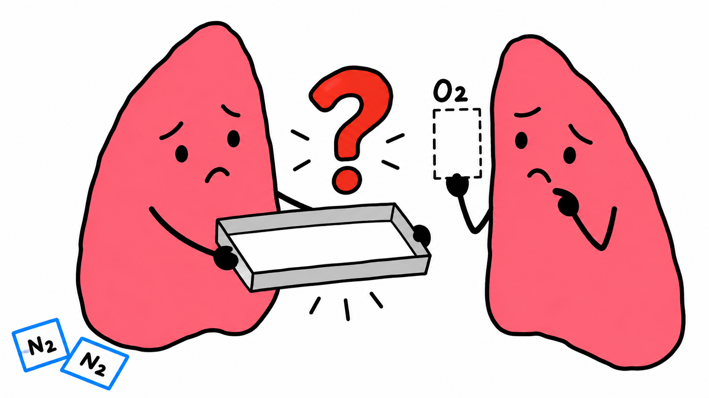
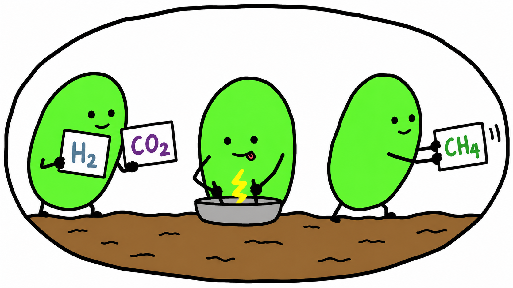

# xigua-msvideo-skill

一套面向 **Codex** 的 YouTube 知识视频制作技能：从选题、英文口播和中文审稿，到配音、时间戳分镜、MS Paint 粗绘图片与 MP4 合成。

**Codex skills for research-backed curiosity stories, MS Paint storyboards, and narrated videos.**

可以从头制作一期，也可以带着定稿、配音或图片从中间继续。默认中文沟通、英文口播、白底粗黑线和平涂画面；语言、时长、风格以本次要求为准。

> 这是供 AI 助手执行的技能包。文本研究和生图需要宿主提供相应工具；仓库中的 Python 脚本负责配音、素材检查与本地合成，没有独立的一键全自动生图服务。

## 包含什么

| 技能 | 负责内容 | 适合的请求 |
| --- | --- | --- |
| [`xigua-msvideo-skill`](skills/xigua-msvideo-skill/SKILL.md) | 六阶段统筹、素材交接、进度续作、配音与合成 | “完成这期视频”或“从现有音频继续” |
| [`youtube-curiosity-stories`](skills/youtube-curiosity-stories/SKILL.md) | 选题、查证、完整口播、中英文同步修改 | “先给选题”或“根据中文修改英文” |
| [`youtube-ms-paint-images`](skills/youtube-ms-paint-images/SKILL.md) | 时间戳分镜、粗绘提示词、独立配图和逐帧核对 | “先做分镜”或“按确认的分镜生成图片” |

全流程依次交付：**选题 → 文案 → 配音 → 时间戳分镜 → 独立图片 → MP4**。

## 画面示例

| 人物与动作 | 拟人机制图 |
| --- | --- |
|  |  |
|  |  |

样图用于说明人物主次、动作和配色；题材与角色可以改变。文件名保留示例的原始估算时间，不能当作新项目的真实配音时码。样图接近 16:9，合成时等比补白到指定尺寸。具体说明见[示例文档](skills/youtube-ms-paint-images/references/ancient-earth-example.md)。

## 安装到 Codex

下载仓库 ZIP 并解压，或使用 Git 克隆：

```sh
git clone https://github.com/124zhe/xigua-msvideo-skill.git
cd xigua-msvideo-skill
```

在仓库根目录运行：

```sh
python scripts/install.py
```

需要 Python 3.10+。安装器把三个技能一起复制到 `$CODEX_HOME/skills`；未设置 `CODEX_HOME` 时使用 `~/.codex/skills`。它先检查全部目标，同名技能已存在就停止，不覆盖已有版本。重新打开 Codex 会话后，通过 `$xigua-msvideo-skill` 调用。

也可以指定技能目录，或只查看安装计划：

```sh
python scripts/install.py --dry-run
python scripts/install.py --destination "/path/to/skills"
```

没有 Python 时，手动将 `skills/` 下的三个完整文件夹复制到 Codex 技能目录即可。不要只复制 `SKILL.md`；`references/`、`scripts/` 和 `assets/` 也会被使用。升级前备份同名技能，再自行合并或替换。

## 直接复制使用

### 从选题开始

```text
使用 $xigua-msvideo-skill，给我 5 个普通人容易好奇的科学或历史选题。
默认英文口播、中文审稿，目标约 8 分钟。先只做选题。
```

### 制作一整期

```text
使用 $xigua-msvideo-skill，围绕“为什么人很难记住婴儿时期的事情”制作一期视频。
先核查资料，再写英文口播和中文审稿版。
文案先给我审阅；确认后使用我的配音，制作白底 MS Paint 粗绘分镜和成片。
```

### 从已有素材继续

```text
使用 $xigua-msvideo-skill。最终口播在 outputs/episode/narration.txt，
最终音频在 outputs/episode/audio/narration.mp3。口播不改。
先核对真实音频时间，制作时间戳分镜；这轮先不生图。
```

### 单独写稿或生图

```text
使用 $youtube-curiosity-stories，根据我修改后的中文稿同步英文，保留删减和结尾。
```

```text
使用 $youtube-ms-paint-images，按照确认的 storyboard.json 生成图片。
每个时间点一张独立图，继承认可样图，按分镜编号和开始时间戳命名。
```

## 环境与依赖

| 工作 | 需要什么 |
| --- | --- |
| 选题、写稿 | 能加载技能的 AI 助手；事实查证需要可用的检索工具或用户提供的资料 |
| 画面生成 | 宿主的图像生成和查看能力；可使用 Codex 内置生图，仓库不附图片 API 密钥或生图脚本 |
| 命名计划、PNG 文件头检查 | Python 3.10+，仅标准库 |
| 本地视频合成 | Python 3.10+，FFmpeg、FFprobe；FFmpeg 需支持 `libx264` 和 `aac` |
| Edge 配音 | 上述媒体环境、`edge-tts` 与联网；使用 Microsoft 在线 TTS 服务 |
| ChatCut 可编辑工程 | 另外安装并配置 ChatCut；这是可选路线 |

只写稿或用现有配音时，不需要安装 `edge-tts`。要运行配音脚本，建议在项目虚拟环境中执行：

```sh
python -m pip install -r skills/xigua-msvideo-skill/requirements-tts.txt
ffmpeg -version
ffprobe -version
```

`requirements-tts.txt` 固定了已核对 `WordBoundary` 接口的版本。Edge TTS 需要联网，服务可用性与限制可能变化；生图或其他工具的费用取决于使用环境。本仓库不把任何路线承诺为永久免费，也不会自行转付费服务。

## 脚本怎么用

以下命令均在仓库根目录运行。实际生产中也可以使用安装后的技能脚本绝对路径。

**1. 从干净朗读文本生成配音和逐词时间：**

```sh
python skills/xigua-msvideo-skill/scripts/narrate_edge.py --text outputs/episode/narration.txt --work work/episode/tts --out outputs/episode/audio --voice en-US-BrianNeural --rate=+0%
```

输出 `narration.mp3`、`word-timings.json`、`audio-manifest.json`。文本不要混入标题、编辑备注和来源链接。缓存按文字及声音参数核对，完整交付不覆盖，改稿后使用新版本输出目录。

**2. 从分镜制作命名计划：**

```sh
python skills/youtube-ms-paint-images/scripts/frame_manifest.py plan --storyboard examples/storyboard.estimated.json --out-dir work/example-plan
```

内附示例仅用于规划，状态为 `estimated`，不包含真实音频和待生成图片。准备好图片后可以检查库存：

```sh
python skills/youtube-ms-paint-images/scripts/frame_manifest.py audit --plan work/example-plan/frame-plan.json --image-dir outputs/episode/images
```

未生成示例图片时，返回缺帧及非零退出码是预期行为。此检查读取 PNG 文件头和宽高，不能代替图像解码和人工画面检查。

**3. 用真实配音和已审核图片合成：**

```sh
python skills/xigua-msvideo-skill/scripts/assemble_video.py --storyboard outputs/episode/storyboard.json --out outputs/episode/final.mp4 --work work/episode/render
```

默认 1920×1080、30 fps、H.264/AAC、静态硬切、旁白连续。可通过 `--ffmpeg` 和 `--ffprobe` 指定可执行文件路径。完整数据字段见[产物约定](skills/xigua-msvideo-skill/references/contracts.md)。

合成前需要真实音频的时长、SHA256、已核验的对齐状态，以及每张图片的审核状态和 SHA256。估时分镜或尚未审核的图片会被拒绝；不要为了运行脚本修改成虚假的通过状态。技术验证后仍需检查图文对应和试听配音。

## 目录结构

```text
xigua-msvideo-skill/
├── README.md
├── LICENSE
├── scripts/install.py
├── examples/storyboard.estimated.json
├── tests/test_workflow.py
├── .github/workflows/check.yml
└── skills/
    ├── xigua-msvideo-skill/
    │   ├── SKILL.md
    │   ├── requirements-tts.txt
    │   ├── agents/
    │   ├── references/
    │   └── scripts/
    ├── youtube-curiosity-stories/
    │   ├── SKILL.md
    │   ├── agents/
    │   └── references/
    └── youtube-ms-paint-images/
        ├── SKILL.md
        ├── agents/
        ├── references/
        ├── scripts/
        └── assets/
```

项目中间文件放 `work/<episode>/`，实际交付放 `outputs/<episode>/`，二者均被 `.gitignore` 排除。仓库只保存可复用技能和明确用于展示的样图。

## 本地检查

```sh
python -B -m unittest discover -s tests -v
```

检查包括安装器拒绝覆盖、文本分段、时间戳命名、缺帧识别和媒体合成。安装 FFmpeg/FFprobe 后还会运行离线合成与缓存复用检查；缺少媒体工具时这些项显示跳过。测试使用临时目录、样图和人工测试音，不调用在线配音或生图服务。GitHub Actions 配置会在推送后执行检查。

## 仓库与贡献

仓库地址：[124zhe/xigua-msvideo-skill](https://github.com/124zhe/xigua-msvideo-skill)。

可以通过 Issue 反馈问题，或通过 Pull Request 提交改进。修改脚本后请运行本地检查；不要提交自己的配音、成片、缓存或密钥。

## 许可与素材说明

本仓库采用 [MIT License](LICENSE)。四张样图来自随技能保存的生成示例，保留原文件用于画风参考。参考文档中的外部 YouTube 视频链接用于分析叙事和画面，不包含这些视频的文件或完整字幕；外部作品与第三方服务不属于本仓库的授权范围。
